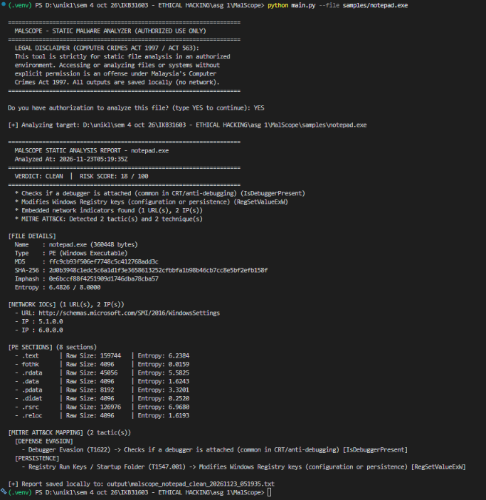
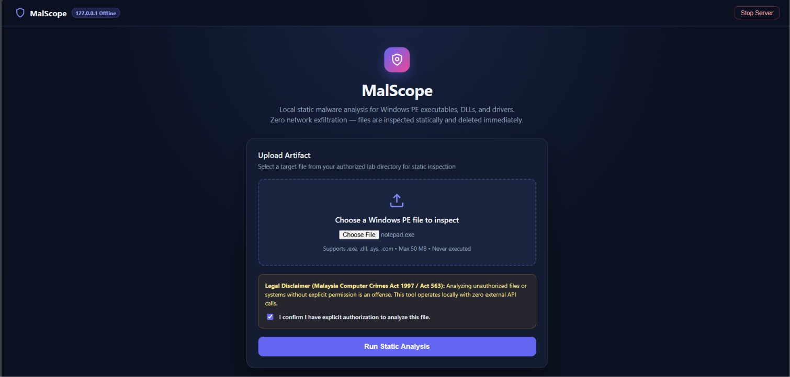
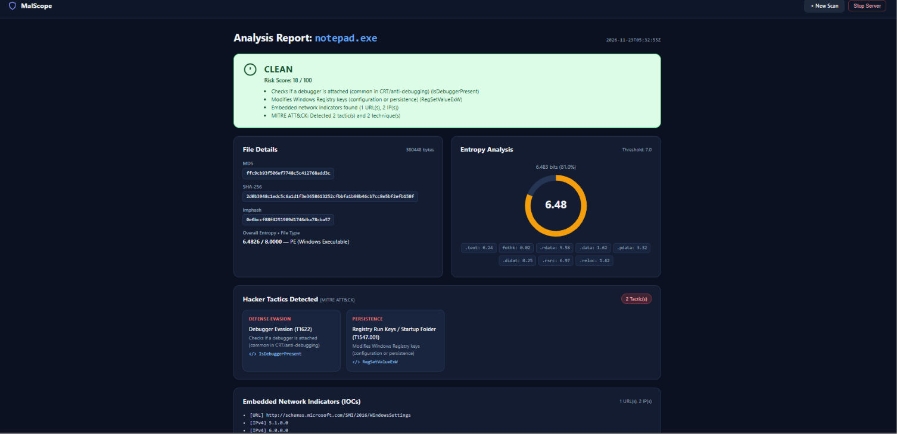

# MalScope — Local Static Malware Analyzer

**Course:** IKB31603 — Ethical Hacking  
**Group:** GoodGuys (Muhammad Sufi bin Md Arif, Azim, Hakimi, Azamuddin)  
**Category:** Malware Analysis (Static Analysis Only)

MalScope is a local-only static malware triage tool built in Python for inspecting Windows Portable Executable (PE) files (`.exe`, `.dll`, `.sys`, `.com`). It computes cryptographic hashes, parses PE headers and section entropy, extracts embedded network indicators (URLs and IPv4 addresses), and maps suspicious Windows API imports to **MITRE ATT&CK** tactics and techniques via both a Command-Line Interface (CLI) and a dark-theme local Flask Web UI.

---

## 1. Architecture & Project Structure

```text
+-------------------+      +---------------------+      +-------------------------+
|  CLI (main.py)    | ---> |  Guardrails         | ---> |  Core Engine (core.py)  |
|  Web UI (app.py)  |      |  - CCA 1997 Consent |      |  - pe_parser.py (Hashes |
+-------------------+      |  - Scope & 50MB Cap |      |    & PE Headers/Imports)|
                           |  - Kill Switches    |      |  - analyzers.py         |
                           +---------------------+      |    (Entropy & IOC Regex)|
                                                        |  - rules.py (MITRE Map) |
                                                        |  - risk.py (0-100 Score)|
                                                        +------------+------------+
                                                                     |
                                                                     v
                                                        +-------------------------+
                                                        |  Local Output / Web UI  |
                                                        |  - output/*.txt / .json |
                                                        |  - 127.0.0.1 Dashboard  |
                                                        +-------------------------+
```

### Repository Layout

- `main.py` — CLI entry point, argument parser, and `--serve` web launcher.
- `rules.json` — Detection rules for 40 Windows APIs, tuned weights, entropy threshold (7.0), and MITRE ATT&CK mappings.
- `malscope/guardrails.py` — Legal authorization banner, directory scope validation, 50 MB size check, and Ctrl+C kill switch.
- `malscope/pe_parser.py` — PE header validation, MD5 / SHA-256 / imphash computation, section extraction, and import table parsing.
- `malscope/analyzers.py` — Shannon entropy calculation (0.0–8.0) and raw byte IOC extraction (URLs and IPv4 addresses).
- `malscope/rules.py` — Rule loader, ANSI/Unicode (A/W) API normalizer, and MITRE ATT&CK tactic grouping.
- `malscope/risk.py` — Heuristic risk scoring engine (0–100), verdict assignment (`CLEAN`, `SUSPICIOUS`, `MALICIOUS`, `UNSUPPORTED`), and reason builder.
- `malscope/core.py` — Unified `analyze_file()` pipeline, shared `render_text()` formatter, and local report saver.
- `web/app.py` & `web/templates/` — Offline Flask Web UI (127.0.0.1) with server-side consent validation and Host/Origin CSRF protection.
- `samples/` — Authorized local sample directory (only `.gitkeep` is tracked in Git; binaries are excluded).
- `tests/` — Safe sample generator (`make_samples.ps1`) and recorded test results (`test_results.md`, `Test_Results.pdf`).
- `output/` — Local report directory (`.txt` and `.json` outputs; ignored by Git).
- `docs/` — Documentation screenshots for CLI and Web UI reports.

---

## 2. Attack Lifecycle & MITRE ATT&CK Mapping

In the incident response and cyber attack lifecycle, MalScope operates in the **Pre-Execution / Post-Incident Artifact Triage** phase, allowing analysts to inspect suspicious binaries safely before detonation or sandbox execution.

| Lifecycle / MITRE Tactic | Technique ID & Name | Monitored Windows APIs | Analyst Significance |
|---|---|---|---|
| Execution | T1059 Command and Scripting Interpreter | `ShellExecuteA` / `W` | Spawns secondary scripts, payloads, or system utilities. |
| Persistence | T1547.001 Registry Run Keys / Startup Folder | `RegSetValueExA` / `W` | Modifies Windows Registry keys to survive system reboots. |
| Defense Evasion | T1055 Process Injection | `VirtualAllocEx`, `WriteProcessMemory`, `CreateRemoteThread` | Allocates and executes malicious shellcode inside legitimate processes. |
| Defense Evasion | T1622 Debugger Evasion | `IsDebuggerPresent` | Detects attached debuggers to alter behavior or hide payloads. |
| Collection | T1056.001 Input Capture: Keylogging | `GetAsyncKeyState` | Captures user keystrokes to steal credentials or sensitive input. |
| Command & Control | T1071 Application Layer Protocol / T1105 Ingress Tool Transfer | `InternetOpenA` / `W`, `URLDownloadToFileA` / `W` | Establishes C2 channels or downloads additional malware stages. |
| Impact | T1486 Data Encrypted for Impact | `CryptEncrypt` | Encrypts local user files (common ransomware indicator). |

*The table shows representative rules. The full set of 40 monitored APIs and their weights is defined in `rules.json`.*

---

## 3. Rules of Engagement (RoE)

All usage and testing of MalScope follow five strict Rules of Engagement:

1. **Authorized Scope:** File inspection is strictly confined to explicit local lab directories (`samples/` by default, or user-approved `--allow-dir` folders) and localhost (`127.0.0.1`) for the Web UI.
2. **Time Windows:** Executed solely during scheduled IKB31603 coursework development, controlled lab testing, and official lecturer demonstration/evaluation sessions (October–November 2026).
3. **Permitted Techniques:** Non-intrusive, read-only static binary analysis (cryptographic hashing, PE header/section inspection, Shannon entropy calculation, regex IOC extraction, and rule-based API matching).
4. **Prohibited Actions:**
   - **No Execution:** Target binaries are never executed, loaded via `ctypes`/DLL loading, or detonated.
   - **No Network Activity:** Zero outbound HTTP/API requests, hash lookups, or telemetry uploads.
   - **No Unauthorized Access:** Scanning system directories outside approved scope or analyzing third-party proprietary files without authorization is prohibited.
5. **Emergency Stop (Kill Switches):**
   - **CLI:** Press `Ctrl + C` at any stage to trigger the SIGINT handler for immediate termination.
   - **Web UI:** Click **Stop Server** (`POST /shutdown`) to terminate the local server immediately.

---

## 4. Data Handling & Legal Disclaimer

### Data Handling Policy

- **Local Report Storage:** CLI reports are written exclusively to the local `output/` directory as `malscope_<filename>_<verdict>_<timestamp>.txt` or `.json`.
- **Zero External Transmission:** No file contents, hashes, or extracted IOCs are ever transmitted over the network.
- **Ephemeral Web Uploads:** Files uploaded through the local Web UI are saved temporarily under randomized UUID filenames inside `output/.tmp_uploads/` and permanently deleted inside a `finally` block immediately after static analysis completes.
- **Shutdown Behavior:** The Web UI `/shutdown` endpoint uses `os._exit(0)` after a 0.4 s response delay so background Werkzeug threads terminate cleanly without hanging; temporary upload files are already deleted before shutdown.

### Legal Disclaimer (Displayed at Runtime)

```text
====================================================================
  MALSCOPE - STATIC MALWARE ANALYZER (AUTHORIZED USE ONLY)
====================================================================
  LEGAL DISCLAIMER (COMPUTER CRIMES ACT 1997 / ACT 563):
  This tool is strictly for static file analysis in an authorized
  environment. Accessing or analyzing files or systems without
  explicit permission is an offense under Malaysia's Computer
  Crimes Act 1997. All outputs are saved locally (no network).
====================================================================
```

---

## 5. Responsible Disclosure

- **Discovering Active or Real-World Malware:** If MalScope identifies an active malicious sample during authorized triage, do not execute the file or share raw binaries over unsecured channels. Record its SHA-256 hash, network IOCs, and behavior summary, and report the incident to MyCERT (Malaysia Computer Emergency Response Team / Cyber999) via their official portal (<https://www.mycert.org.my>) or the affected organization's Security Operations Center (SOC).
- **Reporting Vulnerabilities in MalScope:** If a security flaw, parser bug, or guardrail bypass is discovered in MalScope itself, please report it responsibly by opening an issue on <https://github.com/msufi00/MalScope/issues> or contacting the GoodGuys project team directly with reproduction steps before public disclosure.

---

## 6. Installation & Preparing Test Samples

**Requirements:** Python 3.9+ (tested on Windows 10/11).

```bash
# 1. Clone the repository
git clone https://github.com/msufi00/MalScope.git
cd MalScope

# 2. Create and activate a virtual environment
python -m venv .venv
# Windows PowerShell:
.\.venv\Scripts\Activate.ps1
# Linux / macOS:
source .venv/bin/activate

# 3. Install dependencies
pip install -r requirements.txt
```

### Preparing Local Test Samples

To respect copyright and safety, `samples/` only tracks `.gitkeep` in Git. Prepare local test files inside `samples/` before running commands:

```powershell
# 1. Create the safe EICAR standard antivirus test file (default CLI target, must be exactly 68 bytes)
#    Single quotes are required: PowerShell expands $EICAR and $H inside double quotes and corrupts the string.
Set-Content -Path samples/eicar.com -Value 'X5O!P%@AP[4\PZX54(P^)7CC)7}$EICAR-STANDARD-ANTIVIRUS-TEST-FILE!$H+H*' -Encoding ascii -NoNewline

# 2. Copy a legitimate Windows PE binary for baseline testing (do not commit to Git)
Copy-Item "C:\Windows\System32\notepad.exe" -Destination "samples\notepad.exe"

# 3. Create a non-PE dummy file to test UNSUPPORTED handling
python -c "from pathlib import Path; Path('samples/fake_test.exe').write_text('not a valid PE binary', encoding='utf-8')"
```

To generate all edge-case samples at once (empty file, 45 MB and 51 MB size-cap files, non-PE file, EICAR, baseline binary), run `.\tests\make_samples.ps1` from the project root. Recorded results are in `tests/test_results.md`.

---

## 7. Usage

### Command-Line Interface (CLI)

```bash
# Scan the default target (samples/eicar.com -> MALICIOUS 100/100)
python main.py

# Scan a legitimate Windows PE binary (samples/notepad.exe -> CLEAN 19/100)
python main.py --file samples/notepad.exe

# Export structured JSON report locally to output/
python main.py --file samples/notepad.exe --format json

# Validate scope and file size without writing a report
python main.py --file samples/eicar.com --dry-run

# Scan a file in another authorized directory
python main.py --file D:/TestLab/sample.exe --allow-dir D:/TestLab
```

### Local Flask Web UI

```bash
python main.py --serve
```

1. Open <http://127.0.0.1:5000> in your browser.
2. Select a Windows PE file (`.exe`, `.dll`, `.sys`, `.com`, max 50 MB).
3. Tick the Computer Crimes Act 1997 authorization checkbox and click **Run Static Analysis**.
4. Click **Stop Server** when finished to terminate the local session.

---

## 8. Screenshots

Screenshots of the CLI output and Web UI dashboard are stored in `docs/`.

**CLI Static Analysis Output** (`docs/cli_output.png`):



**Local Web UI Upload & Legal Gate** (`docs/web_upload.png`):



**Dark-Theme Analysis Dashboard & MITRE ATT&CK Cards** (`docs/web_report.png`):



---

## 9. Limitations

- **No Dynamic Unpacking:** Packed or obfuscated binaries (e.g., UPX) are flagged via high section entropy (> 7.0), but compressed import tables are not unpacked prior to static inspection.
- **Runtime API Resolution:** APIs loaded dynamically at runtime via `LoadLibrary` and `GetProcAddress` do not appear in the static Import Address Table (IAT).
- **ASCII IOC Extraction:** The IOC regex scans ASCII byte sequences only and may miss UTF-16LE wide strings. Well-known XML schema URLs and version-like numbers (e.g. `5.1.0.0`) are filtered out, but other benign strings can still appear as IOC candidates.

---

## 10. License

Licensed under the MIT License — see [LICENSE](LICENSE) for details.
